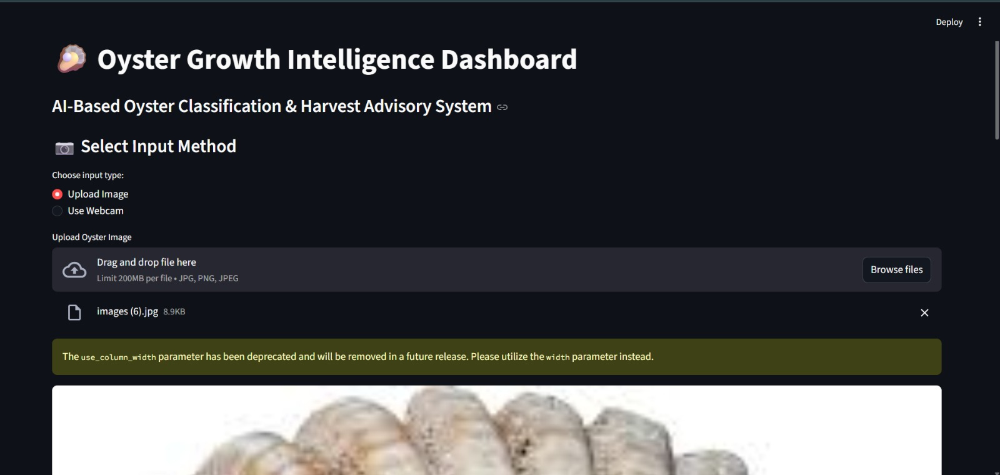
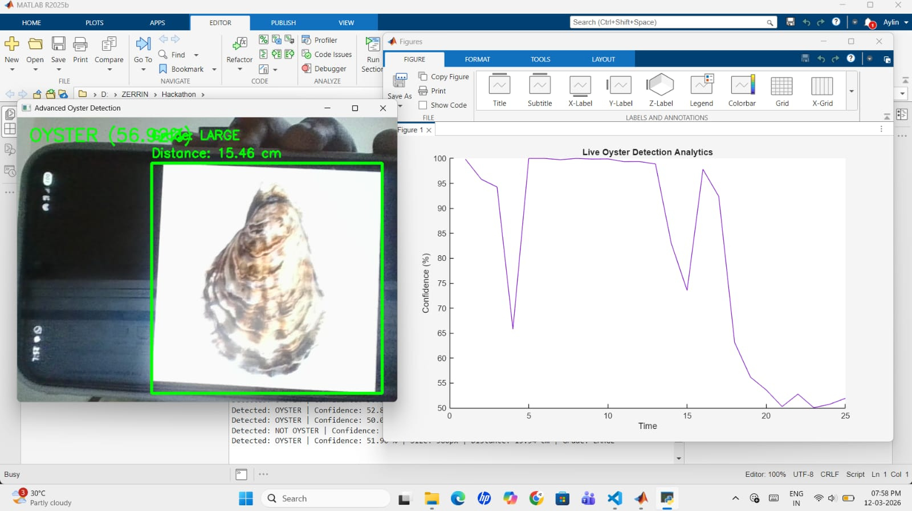
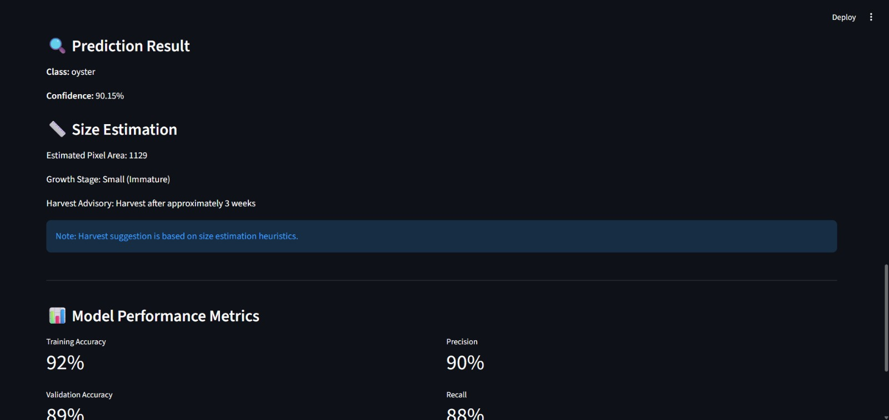
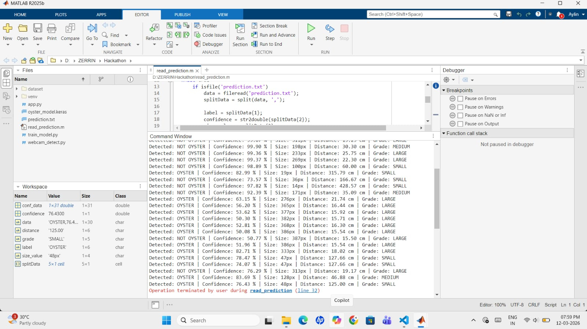
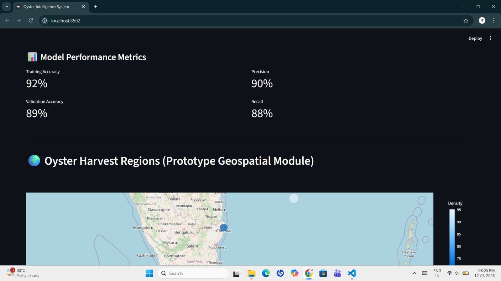
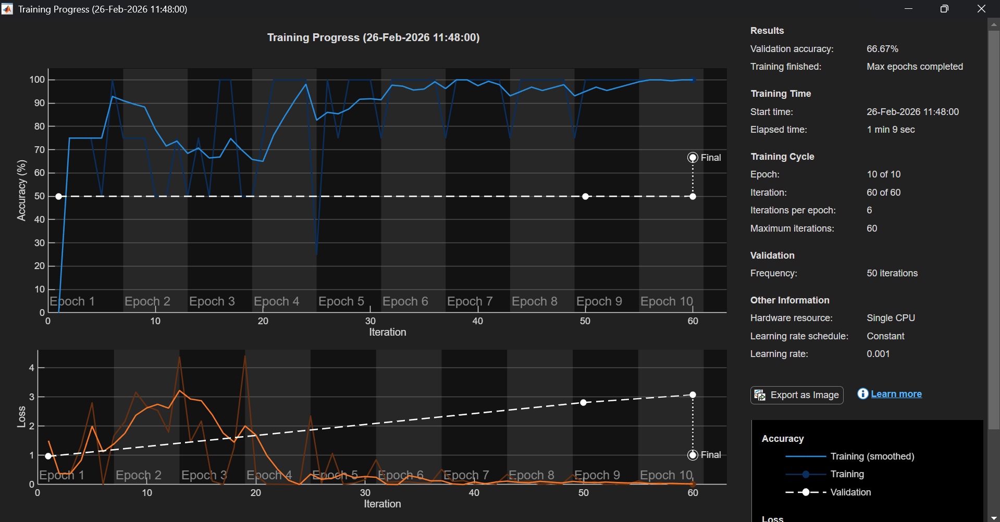

# 🦪 AquaCatch – AI-Driven Oyster Detection and Smart Harvest Advisory System

**An AI-powered approach to oyster detection, growth-stage analysis and sustainable aquaculture.**

## 📌 Project Overview

AquaCatch is an academic project developed by **Team ImpactX** that explores the application of Artificial Intelligence, Computer Vision and Deep Learning in oyster farming.

The system focuses on identifying oysters from images, analysing their growth stages and providing information to support smarter harvesting decisions.

## 🎯 Problem Statement

Traditional oyster monitoring and harvesting practices can involve considerable manual effort. Identifying oyster maturity and estimating growth can also be challenging.

AquaCatch explores an AI-based approach to support oyster identification, growth analysis and harvest advisory.

## 💡 Project Objectives

- Automate oyster detection using computer vision.
- Classify oysters based on visual characteristics.
- Estimate oyster size and growth stage.
- Present detection results through a user-friendly dashboard.
- Explore geospatial visualization for harvesting regions.

## ⚙️ Key Features

- **Oyster Detection:** YOLO-based object detection.
- **Image Classification:** CNN-based classification using ResNet-18.
- **Size Estimation:** Analysis of oyster dimensions from image data.
- **Growth-Stage Analysis:** Identification of oyster growth stages.
- **Interactive Dashboard:** Streamlit-based result visualization.
- **Geospatial Visualization:** Mapping of oyster harvesting regions.

## 🛠️ Technologies Used

| Category | Technologies |
|---|---|
| Programming | Python, MATLAB |
| AI / Deep Learning | TensorFlow, Keras, CNN |
| Object Detection | YOLO |
| Image Processing | Computer Vision |
| Dashboard | Streamlit |
| Model | ResNet-18 |

## 📂 Project Structure

```text
AquaCatch-AI-Oyster-Detection/
│
├── app.py
├── train_model.py
├── webcam_detect.py
├── read_prediction.m
├── prediction.txt
│
├── model/
│   └── oyster_model.keras
│
├── screenshots/
│
├── requirements.txt
└── README.md
```

## 🖥️ Project Workflow

1. Capture or provide oyster images.
2. Process images using computer vision techniques.
3. Detect oysters using the object detection model.
4. Classify oysters and analyse their growth characteristics.
5. Estimate size and generate prediction results.
6. Display outputs through the Streamlit dashboard.

## 🚀 Getting Started

### Prerequisites

- Python 3.x
- pip
- MATLAB (for MATLAB-based scripts)

### Installation

Clone the repository:

```bash
git clone https://github.com/GopikaR06-collab/AquaCatch-AI-Oyster-Detection.git
```

Navigate to the project directory:

```bash
cd AquaCatch-AI-Oyster-Detection
```

Install the required Python packages:

```bash
pip install -r requirements.txt
```

### Run the Dashboard

```bash
streamlit run app.py
```

*Note: The application may require the trained model and other project resources to be available in their expected locations.*

## 📸 Project Screenshots

### Streamlit Dashboard


### Oyster Detection


### Prediction and Size Estimation


### Live Detection and Analytics


### Geospatial Visualization


### Model Training


## 👥 Team ImpactX

Developed as a collaborative academic project at **Francis Xavier Engineering College**.

- Aylin Zerrin C
- Gopika R
- Imelda Christine
- Jyothika R

## 📈 Project Status

**Currently under development.**

AI model development, prediction analysis and dashboard implementation are ongoing. Further improvements and system integration are planned.

## 🌱 Future Scope

- Improve detection and classification performance.
- Expand oyster growth analysis.
- Integrate real-time monitoring capabilities.
- Develop a more comprehensive smart harvesting advisory system.
- Explore hardware integration for field deployment.

---

**AquaCatch | AI for Smarter and More Sustainable Aquaculture**

*Team ImpactX*
